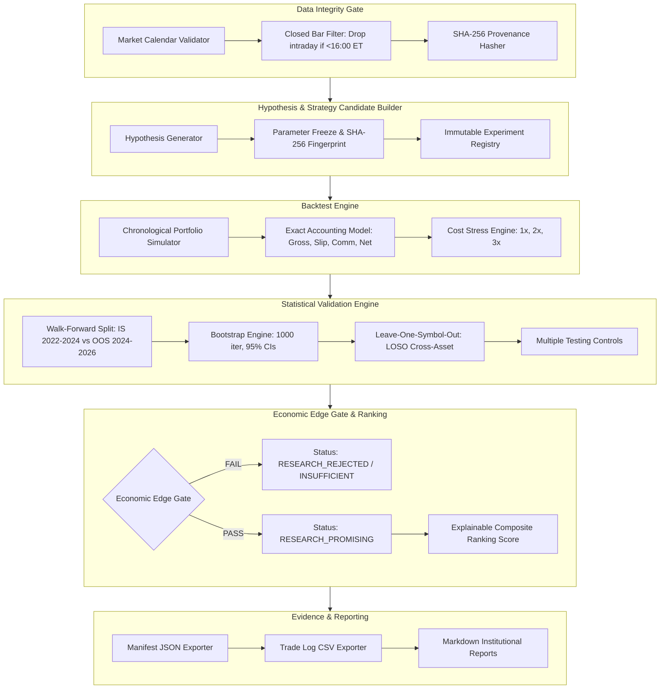

# ORACLEBOT V2 — FASE 7.3: ARQUITECTURA DEL STRATEGY DISCOVERY ENGINE V2
## DISEÑO MODULAR, FLUJO CIENTÍFICO Y SALVAGUARDAS DE AISLAMIENTO

**Módulo:** `ai_trading_agent.strategy_lab.discovery.discovery_engine_v2`  
**Workspace Canónico:** `trading-app-repo`  
**Fecha de Implementación:** 30 de octubre de 2026  
**Modo de Ejecución:** `RESEARCH / ANALYSIS_ONLY` (Air-Gapped de brokers)

---

## 1. VISIÓN GENERAL Y PRINCIPIOS DE INGENIERÍA

El **Strategy Discovery Engine v2** transforma el laboratorio de investigación de OracleBot en un motor automatizado, modular y matemáticamente estricto, diseñado para generar y validar hipótesis cuantitativas sin intervención manual en cada cálculo y sin riesgo de sobreajuste.

### Principios Fundamentales
1. **Presupuesto Cerrado de Búsqueda:** Prohibido el *brute-force parameter sweep* indiscriminado. Se evalúan hipótesis pre-registradas.
2. **Barras Estrictamente Cerradas:** Imposibilidad de que datos intradía parciales alimenten simulaciones diarias.
3. **Contabilidad Forense al Centavo:** `True Net PnL = True Gross PnL - Slippage USD - Commissions USD`.
4. **Compuerta Eliminatoria Temprana (*Economic Edge Gate*):** Rechazo inmediato de estrategias deficitarias, frágiles a costes o estadísticamente indistinguibles de ruido.
5. **Aislamiento Total de Producción:** Cero importación de adaptadores de broker reales o credenciales operativas.

---

## 2. DIAGRAMA MODULAR DEL DISCOVERY ENGINE V2

---

## 3. DESCRIPCIÓN DE COMPONENTES DEL MOTOR

### 1. Data Integrity Gate (`DataIntegrityGate`)
- Valida la pertenencia de cada barra a sesiones oficiales NYSE/NASDAQ vía `MarketCalendarService`.
- Comprueba si la fecha coincide con la fecha de ejecución y la hora es anterior a las 16:00 ET; si es así, descarta la barra en formación.
- Genera el hash criptográfico SHA-256 inmutable de las barras retenidas.

### 2. Hypothesis Generator & Candidate Builder
- Formula hipótesis con base económica verificable:
  - **Familia A:** *Cross-Sectional Relative Momentum* (ordenamiento y rotación sectorial).
  - **Familia B:** *Volatility-Conditioned Mean Reversion* (reversión a la media modulada por ATR y Bandas de Bollinger).
  - **Familia C:** *Market Regime Adaptive Allocation* (en diseño conceptual).
- Congela los parámetros y genera una firma determinista SHA-256 (`compute_source_fingerprint`).

### 3. Backtest Engine Cronológico
- Ejecuta operaciones sin solapamiento barra a barra.
- Registra precios de entrada y salida reales (mid-prices) y deduce explícitamente:
  - Deslizamiento (*Slippage*): tasa aplicada tanto en entrada como en salida.
  - Comisiones fijas por acción.
- Simula 3 niveles de fricción institucional:
  - **1x Base:** $0.005/acción, 5 bps slippage.
  - **2x Moderado:** $0.010/acción, 10 bps slippage.
  - **3x Severo:** $0.015/acción, 15 bps slippage.

### 4. Statistical Validation Engine
- **Walk-Forward:** Divide el historial en *In-Sample* (0 a 599 barras, 2022 a 2024) y *Out-of-Sample* (600 a 1199 barras, 2024 a 2026).
- **Bootstrap no paramétrico:** 1,000 resamples con reemplazo para calcular $p(\text{loss})$ e intervalos de confianza al 95%.
- **Leave-One-Symbol-Out (LOSO):** Verifica si el portafolio sobrevive al excluir cada uno de los 6 activos.

### 5. Economic Edge Gate & Ranking Engine
- Compuerta objetiva con criterios eliminatorios:
  - Mínimo 15 operaciones.
  - PnL neto en 1x $> 0$.
  - PnL neto en OOS $> 0$.
  - PnL neto bajo costes 2x $> 0$.
  - Probabilidad bootstrap de pérdida $p(\text{loss}) \le 25\%$.
- Score de ranking explicable:
  $$\text{RankScore} = 0.40 \cdot \min\left(1.0, \frac{\text{PF}_{\text{OOS}}}{3.0}\right) + 0.30 \cdot \mathbb{I}_{(\text{PnL}_{\text{OOS}} > 0)} + 0.20 \cdot \text{CostSurvival} + 0.10 \cdot \text{LOSO\_Consistency}$$

---

## 4. GARANTÍAS DE AISLAMIENTO Y SEGURIDAD

1. **Air-Gap de Brokers:** El módulo `discovery_engine_v2.py` no importa ni instancia `moomoo_adapter`, `alpaca_adapter` ni `unified_broker`.
2. **Inmunidad de D21:** Las ejecuciones del motor operan en scripts y memoria de investigación independientes. El daemon de D21 en puerto 8090 no es perturbado.
3. **Bloqueo LIVE:** Ninguna interfaz del discovery engine tiene capacidad de ruteo de órdenes a mercado.
